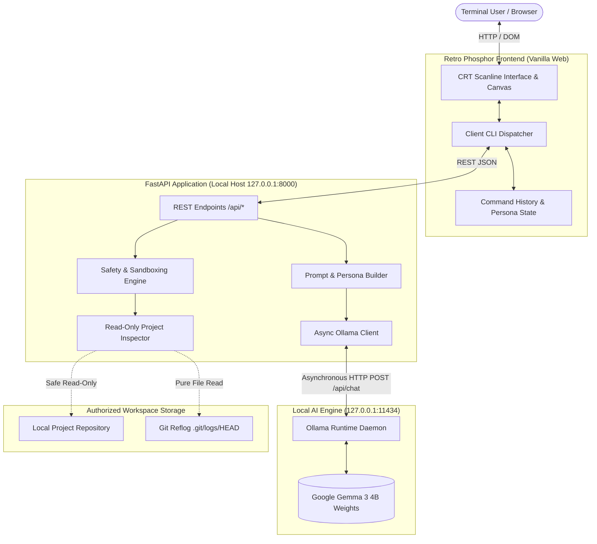

# GhostShell — The Ghost in Your Terminal 👻

> *"Every repository has a past. Every commit leaves a trace. GhostShell gives that forgotten history a voice."*

[](LICENSE)
[](https://www.python.org/downloads/)
[](https://fastapi.tiangolo.com)
[](https://ai.google.dev/gemma)
[](https://hacktoberfest.com)

**GhostShell** is a local-first, retro phosphor terminal companion built for **Hacktoberfest 2026's "Ghost in the Machine" challenge**. It transforms forgotten Git history, lingering TODOs, and complex shell commands into interactive developer insights and atmospheric micro-fiction — running 100% locally on your machine powered by Google's open-weight **Gemma 3 4B** model via **Ollama**.

---

## 1. The Problem Statement

Modern AI developer tools suffer from two major flaws:
1. **Privacy Invasions**: They require uploading proprietary source code, internal architecture diagrams, and commit histories to cloud providers.
2. **Security Vulnerabilities**: Autonomous agents with unrestricted shell execution access pose extreme risks to host systems.

**GhostShell inverts this paradigm:**
- **Zero Cloud Telemetry**: All inference runs locally on your hardware.
- **Zero Command Execution**: GhostShell explains commands and inspects files, but *never* executes commands via shell or subprocess.
- **Bounded Sandboxing**: Strict path traversal and symlink confinement protect your machine.

---

## 2. Feature Overview

| Feature | Description | Safety Guarantee |
| :--- | :--- | :--- |
| **Haunted Terminal UI** | Retro phosphor green CRT display with scanlines, ambient glow, and boot sequence. | 100% offline; zero external fonts or CDN trackers. |
| **Safe Command Explainer** | Breaks down shell commands by intent, flags, system effects, and risks. | Pure token analysis; zero subprocess execution. |
| **Project Inspector** | Read-only scan of repo structure, manifests, and lingering TODOs. | Path traversal blocked; secrets (`.env`, keys) excluded. |
| **Reflog Archaeology** | Safely extracts recent commits from `.git/logs/HEAD`. | Direct text parsing in Python; zero shell calls. |
| **Gothic Micro-Fiction** | Generates fictional horror micro-stories inspired by real code remnants. | Explicit fictional disclaimer attached to every story. |
| **Multi-Persona Companion** | Seamlessly switch between Ghost, Developer, and Storyteller. | Dynamic system prompt switching without server restart. |

---

## 3. Visual Interface & Screenshots

```
+-----------------------------------------------------------------------------------------+
| [☠] GHOSTSHELL // v1.0   [STATUS: ONLINE (READY)]   [👻 GHOST] [⚙️ DEV] [📜 STORY] [CLEAR] |
+-----------------------------------------------------------------------------------------+
| [BOOT] Initializing local neural circuitry...                                           |
| [INFO] Connected to Gemma 3 4B at http://127.0.0.1:11434                               |
|                                                                                         |
| ghost@machine:~$ explain git rebase -i HEAD~3                                           |
|                                                                                         |
| 🔍 COMMAND ANALYSIS: git rebase -i HEAD~3                                               |
| [SUMMARY]: Interactive Git history rewriting for the last 3 commits.                    |
| [FLAGS]:                                                                                |
|   -i     : Interactive mode allowing squash, edit, or reword.                           |
|   HEAD~3 : Targets the last three commits from the current branch tip.                 |
| [SYSTEM EFFECTS]: Creates new commit hashes, replacing existing commit history.         |
| [RISK ASSESSMENT]: Modifying public/shared history breaks downstream branches.          |
| [SAFER ALTERNATIVE]: Create a backup branch first: `git branch backup-before-rebase`.   |
|                                                                                         |
| ghost@machine:~$ _                                                                      |
+-----------------------------------------------------------------------------------------+
| INFERENCE: gemma3:4b (Ollama Local)  |  PRIVACY: 100% AIR-GAPPED • ZERO TELEMETRY        |
+-----------------------------------------------------------------------------------------+
```

*(Screenshots will be captured during recording and placed in `docs/screenshots/`)*

---

## 4. Architecture



---

## 5. Technology Stack

- **Backend**: Python 3.11+, FastAPI, Uvicorn, HTTPX (async client), Pydantic v2.
- **AI / Inference**: Google Gemma 3 4B running locally via Ollama.
- **Frontend**: HTML5, CSS3 (CRT scanlines & phosphor glow), Vanilla JavaScript (no framework or build step needed).
- **Testing**: `pytest`, `pytest-asyncio`, `starlette.testclient`.

---

## 6. Prerequisites

1. **Python 3.11 or newer** installed.
2. **Ollama** installed on your operating system ([download from ollama.com](https://ollama.com)).
3. **Gemma 3 4B** model pulled locally:
   ```bash
   ollama pull gemma3:4b
   ```

---

## 7. Installation & Setup

### macOS & Linux
```bash
# 1. Clone the repository
git clone https://github.com/rudrakshk25060-csds/ghostshell.git
cd ghostshell

# 2. Create a virtual environment
python3 -m venv .venv
source .venv/bin/activate

# 3. Install dependencies
pip install -r requirements.txt

# 4. Copy environment configuration
cp .env.example .env
```

### Windows (PowerShell)
```powershell
# 1. Clone and navigate
git clone https://github.com/rudrakshk25060-csds/ghostshell.git
cd ghostshell

# 2. Create and activate virtual environment
python -m venv .venv
.venv\Scripts\Activate.ps1

# 3. Install dependencies
pip install -r requirements.txt

# 4. Copy environment configuration
copy .env.example .env
```

---

## 8. Configuration

Settings are controlled via `.env` or environment variables:

| Variable | Default | Purpose |
| :--- | :--- | :--- |
| `OLLAMA_BASE_URL` | `http://127.0.0.1:11434` | Local Ollama endpoint. |
| `OLLAMA_MODEL` | `gemma3:4b` | Tag of the local model to target. |
| `GHOSTSHELL_MAX_CONTEXT_CHARS` | `12000` | Upper bound for inspected project text. |
| `GHOSTSHELL_CONNECT_TIMEOUT` | `5.0` | Connection timeout for Ollama (seconds). |
| `GHOSTSHELL_READ_TIMEOUT` | `90.0` | Inference generation timeout (seconds). |
| `GHOSTSHELL_AUTHORIZED_ROOT` | *(Workspace parent)* | Ceiling boundary for filesystem inspection. |
| `GHOSTSHELL_MOCK_MODE` | `false` | Enable only for test simulation harness. |

---

## 9. Running GhostShell

1. Start your local Ollama daemon:
   ```bash
   ollama serve
   ```
2. In a separate terminal, launch GhostShell:
   ```bash
   uvicorn app.main:app --host 127.0.0.1 --port 8000 --reload
   ```
3. Open your browser to:
   ```
   http://localhost:8000
   ```

---

## 10. Running Automated Tests

Run the complete 41-test automated test suite (runs in <0.2s without requiring an active Ollama instance):

```bash
pytest -v
```

All unit and security tests execute against an offline mock harness ensuring fast, deterministic, reproducible validation. Live end-to-end integration tests have also been verified against a local Ollama daemon hosting `gemma3:4b`.

---

## 11. Example Commands

| Command | Action | Expected Output |
| :--- | :--- | :--- |
| `explain git rebase -i` | Dissects interactive Git rebase. | Breakdown of `-i` flag, commit rewriting effect, and backup recommendations. |
| `explain rm -rf /tmp/cache` | Analyzes destructive deletion. | Flags high-severity risk alert and recommends safer alternatives. |
| `inspect sample_repo` | Scans safe project metadata. | File tree, detected technologies, Git reflog commits, and lingering TODOs. |
| `story` | Crafts gothic code micro-fiction. | Fictional horror tale inspired by real repository metadata. |
| `status` | Evaluates system health. | Real-time diagnostic check of local Ollama connectivity and model presence. |
| `clear` | Clears screen. | Wipes transcript and re-renders minimal retro boot header. |

---

## 12. Safety Model & Limitations

### Defense in Depth
- **No Command Execution**: The application contains **zero** instances of `os.system` or `subprocess.run` for user input or model output.
- **Path Traversal Protection**: Any path attempting to reach outside `authorized_root` (e.g. `../../etc/passwd`) is immediately blocked.
- **Secret Blacklist**: Files named `.env*`, `*.pem`, `*.key`, `id_rsa*`, or `credentials*` are rejected.
- **Untrusted Context Boundary**: Repository files are isolated in `<<<UNTRUSTED_REPOSITORY_DATA>>>` tags to prevent prompt injection.

### Known Limitations
- Initial download of the Gemma 3 4B model (~2.5GB) requires internet connectivity before offline operation is possible.
- Older hardware without GPU acceleration or Apple Silicon unified memory may experience slower generation times (~5-15s per query).

---

## 13. Roadmap

- [x] Local-first retro phosphor CRT terminal interface.
- [x] Async FastAPI backend communicating with Ollama.
- [x] Safe command explainer (zero subprocess execution).
- [x] Sandboxed read-only repository inspector.
- [x] Pure Python Git reflog parser.
- [x] Multi-personality engine (Ghost, Developer, Storyteller).
- [x] Comprehensive automated test suite (41 tests).
- [ ] Exportable ASCII transcript logs (`save transcript.txt`).
- [ ] Support for customized spooky ASCII themes (Amber CRT, Cyberpunk Blue).

---

## 14. License & Acknowledgments

- Licensed under the **MIT License**. See [LICENSE](LICENSE) for details.
- Google Gemma 3 open-weight models are subject to Google's [Gemma Terms of Use](https://ai.google.dev/gemma/terms).
- Built with passion for **Hacktoberfest 2026: Ghost in the Machine**.
